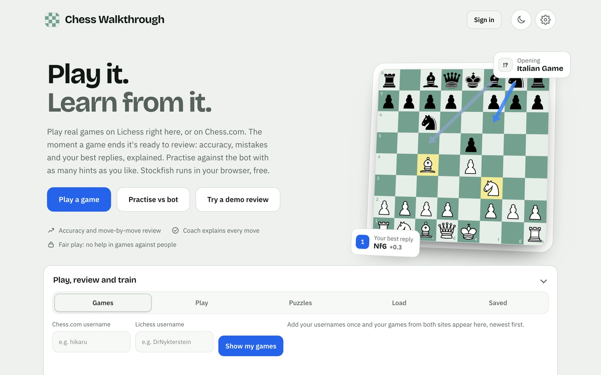

# Chess walkthrough and review coach

> Proof of concept, not a commercial product. This repository is a write-up only; the source code is private.

Live: https://chess.taskly.business

## Problem

After a game, I wanted to understand what I should have played, move by move, in plain language, without uploading my games anywhere.

## What I built

- **Walkthrough:** import a game (Lichess link, Chess.com username or pasted PGN). For every opponent move the app shows my top 3 replies, and I can explore any line as deep as I want.
- **Game review:** accuracy, move quality labels, scores by game phase and a rough rating, then a step-by-step review with a coach that explains each move and spots tactics such as forks, pins and skewers.
- **Play and puzzles:** play on Lichess from the app, practise against a bot from 250 to 3200 strength, and solve puzzles, including positions from my own mistakes.

## Key decisions

- **Everything runs in the browser.** The Stockfish chess engine runs on the device (WebAssembly), so games are never uploaded for analysis.
- **Open, explainable scoring.** Accuracy follows the open Lichess method, and every flagged move is checked again at higher depth before it is labelled.
- **Fair play built in.** Engine help is locked during any game against a real person, including games still in progress on Lichess or Chess.com.
- **Security for saved games.** Secure session cookies, CSRF and same-origin checks on every change, and a strict Content-Security-Policy.

## Stack

JavaScript, Stockfish (WebAssembly), chess.js, Lichess and Chess.com public APIs, Cloudflare Pages, Functions and R2.

## Status

Live and free to use. Personal project.

Built with AI-assisted development (Claude Code).
